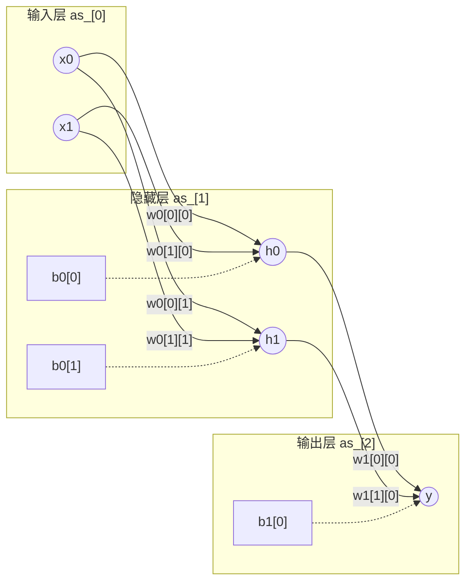

# tinyNN

一个以线性代数运算为基础、用 C++20 实现的极简神经网络库。整个库为 header-only，`main.cpp` 演示用有限差分法训练一个 XOR 网络。

## TODO

1. 项目架构重整
2. **正则化**
    - **权重衰减**
    - **暂退法**
3. 初始化方法
    - **Xavier网络初始化**

## 背景：神经网络的层次

一个前馈神经网络由若干**层**堆叠而成，相邻层之间**全连接**：

- **输入层**：接收特征，本身不计算（无权重/偏置）。
- **隐藏层**：1 层或多层，逐层提取表示。
- **输出层**：给出最终结果。

每个**神经元**对上一层全部输出做加权求和、加偏置，再经激活函数 $f$：

$$
y = f\!\left(\sum_{i=1}^{n} w_i x_i + b\right)
$$

权重按“**每条连接**一个”，偏置按“**每个神经元**一个”。设第 $l$ 层有 $s_l$ 个神经元，则第 $l+1$ 层第 $j$ 个神经元为：

$$
a^{(l+1)}_j
= f\!\left(\sum_{i=1}^{s_l} W^{(l)}_{ij}\, a^{(l)}_i + b^{(l)}_j\right)
$$

即一层是 $s_{l+1}$ 个这样的方程；矩阵 $W^{(l)}$ 的**第 $j$ 列**就是第 $j$ 个神经元的权重向量。写成矩阵形式：

$$
\mathbf{a}^{(l+1)} = f\!\left(\mathbf{a}^{(l)} \mathbf{W}^{(l)} + \mathbf{b}^{(l)}\right)
$$

本项目采用行向量约定（激活为行、batch = 1）：

$$
\mathbf{a}^{(l)} \in \mathbb{R}^{1 \times s_l},\qquad
\mathbf{W}^{(l)} \in \mathbb{R}^{s_l \times s_{l+1}},\qquad
\mathbf{b}^{(l)} \in \mathbb{R}^{1 \times s_{l+1}}
$$

| 记号 | 形状 | 含义 |
|---|---|---|
| $\mathbf{a}^{(l)}$ | $1 \times s_l$ | 第 $l$ 层激活（$s_l$ 个神经元） |
| $\mathbf{W}^{(l)}$ | $s_l \times s_{l+1}$ | 第 $l \to l+1$ 层权重（来源 × 目标；每列一个神经元） |
| $\mathbf{b}^{(l)}$ | $1 \times s_{l+1}$ | 第 $l+1$ 层偏置（每神经元一个） |

层次对应：$2 \times 2 \times 1$ 表示「2 输入 → 1 个隐藏层（2 神经元）→ 1 输出」；$W^{(l)}/b^{(l)}$ 归属**它们所产生的那一层**，共 `层数 − 1` 组（$W^{(0)}/b^{(0)}$ 产生隐藏层，$W^{(1)}/b^{(1)}$ 产生输出层）。



> 实线 = 权重 $W$（每条连接一个），虚线 = 偏置 $b$（每个神经元一个）。每个神经元先对上一层做加权求和、再加偏置，最后经激活函数 $f$。

## 特性

- **header-only**：所有类以单头文件形式放在 `include/`，无独立编译单元。
- **函数式算子**：矩阵运算以自由函数提供（`dot`/`sum`/`fill`/`randomize`/`copy`/`print`），元素访问保留 `operator()`。
- **行视图**：`RowView = std::span<const float>`，非拥有、零开销。
- **架构配置**：`Architecture{inputs, hidden, outputs}` 描述网络结构。
- **可替换激活/损失**：隐藏层与输出层激活分别可配（`Sigmoid`/`Tanh`/`Relu`），损失可选（`MSE`/`BinaryCrossEntropy`）。
- **RAII**：`Matrix` 以 `std::vector<float>` 持有数据，`NN` 以 `std::vector<Matrix>` 持有各层，无需手动释放。
- **持久化**：`Serialization.hpp` 提供 `save`/`load` 对训练数据进行保存。

## 目录结构

```
.
├── CMakeLists.txt
├── main.cpp              # XOR 训练示例
├── NN.h                  # 迁移前的 C 实现，仅作参考
└── include/
    ├── Architecture.hpp  # 网络结构配置
    ├── Util.hpp          # 随机数引擎 rng()/seed_rng()
    ├── Activation.hpp    # 激活策略 Sigmoid/Tanh/Relu + 枚举分派
    ├── Loss.hpp          # 损失策略 MSE/BinaryCrossEntropy + 枚举分派
    ├── Matrix.hpp        # Matrix / RowView / 矩阵算子
    ├── NN.hpp            # NN 类（前向、代价、反向传播、有限差分、学习）
    └── Serialization.hpp # save/load 与二进制格式
```

## 构建与运行

> \>=C++20  
> GCC 13+ / Clang 17+  
> CMake 3.20+

```sh
cmake -S . -B build
cmake --build build -j
./build/main
```

`build/compile_commands.json` 由CMake自动生成

## 使用示例

```cpp
#include "NN.hpp"

nn::Architecture arch{.inputs = 2, .hidden = {2}, .outputs = 1};
nn::NN nn(arch);
// 扁平方式构造
// nn::NN nn({2, 2, 1});
nn::NN g(arch);                       // 梯度缓冲

nn.randomize(0.0f, 1.0f);
// ... 准备训练矩阵 ti (n×2) 与 to (n×1) ...

for (int i = 0; i < 1000000; ++i) {
    nn.finite_diff(g, 1e-3f, ti, to); // 数值梯度
    nn.learn(g, 5e-1f);               // 梯度下降
}

nn.input()(0, 0) = 1.0f;              // 写入输入
nn.input()(0, 1) = 1.0f;
nn.forward();
float y = nn.output()(0, 0);         // 读取输出
```

## 持久化

```cpp
#include "Serialization.hpp"

nn::save(nn, "model.tnn");        // 写文件
nn::NN restored = nn::load("model.tnn");

// 也可用内存缓冲：
nn::Bytes bytes = nn::serialize(nn);
nn::NN m2 = nn::deserialize(bytes);
```

文件格式（所有数值采用小端存储）：

```
u64  file_size                      # 整文件字节数（含自身）
box 'META'
    u16 version                     # 当前为 1
    <dtype>                         # 'FP32' / 'FP16' / 'FP8 '（4 字节字符串）
    box 'ARCH'
        u32 inputs, u32 outputs, u32 hidden_count, u32 hidden[...]
        <strategy> hidden_activation, output_activation, loss
box 'WGHT'   f32[...]               # 按层拼接所有权重
box 'BIAS'   f32[...]               # 按层拼接所有偏置
```

- `<strategy>` = `u8 长度 + ASCII 名称 + 奇数补 0`（名称如 `sigmoid`/`tanh`/`relu`/`mse`/`bce`）。
- 张量形状由 `ARCH` 推导，数据块只存纯数值；未知 FourCC 块按 `size` 跳过，便于前向扩展。

## 说明

- 默认激活为 `Sigmoid`（隐藏层与输出层），默认损失为 `MSE`；可通过 `set_hidden_activation`/`set_output_activation`/`set_loss` 更换。
- 训练支持数值梯度（`finite_diff`）与解析反向传播（`backprop`），两者都与所选激活/损失保持一致。
- `BinaryCrossEntropy` 期望输出层为 sigmoid。
- `Architecture::from_sizes` 会校验尺寸（至少输入+输出且均大于 0），非法输入抛 `std::invalid_argument`；`cost`/`backprop`/`finite_diff` 会校验训练数据维度。
- 矩阵的 `stride` 恒等于 `cols`，因此行连续，可用 `std::span` 表达。

## 附录

### 最初的持久化想法

元信息部分
```
8byte   文件大小
8byte   [size|META]
4byte   FP32/FP16/FP8
8byte   [size|ARCH]         类似于元信息块的子块 是网格的形状 input output hidden
4byte   inputs_size
4byte   outputs_size
4byte...hidden_layer_size
2byte   hide_activation     与output_activation一样，使用枚举值定义
2byte   output_activation
2byte   loss                同样适用枚举值定义
```

对于 hide_activation output_activation loss 另一种可能的存储方式是
```
2byte           size
size byte       string(sigmoid/ralu/tanh/mse/bce)
# 并严格按照 hide output loss 进行排列（三块）在产生奇数位置时 padding 为偶数，但是size大小仍是字符串大小，策略名恒为小/大写
# size 应该是 2byte 还是 1byte 策略名称的长度应该不需要很长
```

数据部分
```
8byte   [size|WGHT/BIAS]
type_size byte...
```

